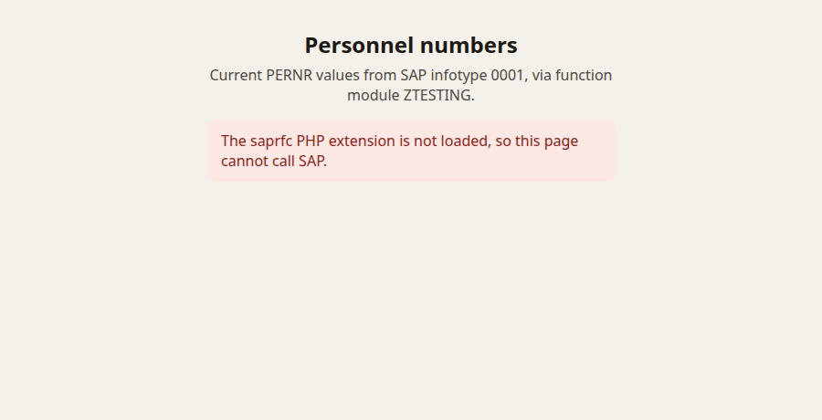
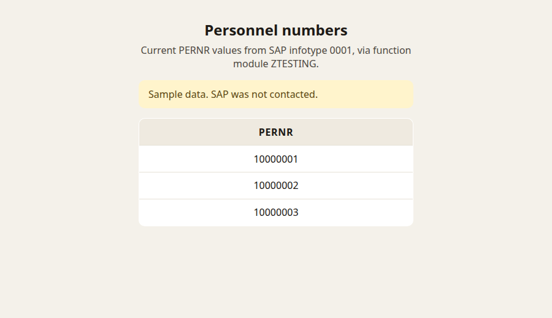

# Zuari SAP Detail

A small PHP page that asks SAP for the personnel numbers (`PERNR`) of organizational assignments active today, then prints them in a table.

Pranav Prem wrote it in January 2014 as internship work for Zuari. The repository description from that time is "Connecting to SAP with PHP for data exchange and display." The commits land on a SAP development system: a custom function module reads infotype 0001, and the PHP page calls that module over RFC. The last change before this refresh was a file rename in September 2016.

The page is an internal-style tool. It has no login of its own. Anyone who can open it and who has the SAP logon configured can see the personnel numbers the function module returns.

## How it works

```
browser
  -> ztesting.php
    -> saprfc class          (saprfc.php, Lars Laegner, 2001)
      -> saprfc PHP extension
        -> SAP RFC
          -> function module ZTESTING
            -> table PA0001 (infotype 0001, Organizational Assignment)
```

`PA0001` stores one row per organizational assignment, with an inclusive validity range (`begda` through `endda`). `ZTESTING` selects the `PERNR` values whose range covers today into a table parameter named `TEMPO` (structure `PA0001`). The page calls that module and prints the `PERNR` column.

The ABAP in [`abap/ztesting.abap`](abap/ztesting.abap) is a reference copy to create in SE37. PHP does not run it. The module has to be remote-enabled, with a `TABLES` parameter `TEMPO` of structure `PA0001`.

The 2014 notes also tried to download that table as a PDF with `GUI_DOWNLOAD` and `OPEN DATASET`. Those calls were left commented out. `GUI_DOWNLOAD` needs a SAP GUI session, and `OPEN DATASET` writes a file on the application server, so neither belongs in a function module called over RFC. They are not part of the reference copy anymore; the old text is still in git history.

## How to run it today

Requirements:

- PHP 8.3 or newer (8.4 is covered in CI)
- the classic `saprfc` PHP extension, built against SAP's classic RFC SDK
- a SAP user that is allowed to call `ZTESTING` remotely

The `saprfc` extension is not on Packagist and not in current Linux distributions. SAP retired the classic RFC SDK in favor of the NetWeaver RFC SDK. This project still speaks the extension it was written against. A live call also needs a SAP system, which this repository does not include and CI does not reach.

Without the extension, the page starts and explains what is missing. It does not fatal on the status code the library returns.

```bash
cp .env.example .env
# fill in SAP_ASHOST, SAP_SYSNR, SAP_CLIENT, SAP_USER, and SAP_PASSWD

composer install
composer serve
```

Open [http://localhost:8080/](http://localhost:8080/) or [http://localhost:8080/ztesting.php](http://localhost:8080/ztesting.php).

`composer install` is only needed for tests and the formatter. The page itself has no PHP dependencies beyond the `saprfc` extension.

To see the table without SAP, set `SAP_DEMO=1` in the environment or in `.env`. The page then shows three obvious sample numbers and a banner that SAP was not contacted. Leave demo mode off if anyone else can open the page.

## Tech stack

| Piece | Role |
| --- | --- |
| PHP 8.3+ | Page and the `saprfc` class |
| `saprfc` extension | RFC client. Optional at runtime; required for a live call |
| HTML and CSS | One centered table of personnel numbers |
| ABAP | Reference source for function module `ZTESTING` |
| PHPUnit 11 | Tests for the class and the page |
| PHP CS Fixer | PSR-12 on the new PHP files |
| GitHub Actions | Lint on PHP 8.3, tests on PHP 8.3 and 8.4 |

Dev dependency versions are pinned in `composer.lock`. There is no production `vendor/` tree.

## Project structure

```
index.php                 Front door. Serves the same page as ztesting.php.
ztesting.php              Page, environment loading, and HTML rendering.
saprfc.php                RFC client class (2001), with PHP 8 fixes.
style.css                 Layout for the table and the error / demo banners.
abap/ztesting.abap        Reference copy of function module ZTESTING.
.env.example              Logon variable names. Copy to .env; do not commit .env.
tests/                    PHPUnit coverage for the class, the page, and the ABAP fix.
.php-cs-fixer.dist.php    Formatter config. saprfc.php is excluded on purpose.
phpunit.xml.dist          Test runner config.
.github/workflows/ci.yml  Lint and tests.
AGENTS.md                 Guide for changing this repository.
```

## Development

```bash
composer test    # PHPUnit
composer lint    # php -l and php-cs-fixer --dry-run
composer format  # apply php-cs-fixer
```

## Screenshots

The shots below were taken with PHP's built-in server and no SAP system. The first is what the page does when the `saprfc` extension is absent. The second is `SAP_DEMO=1`, sample rows only.




